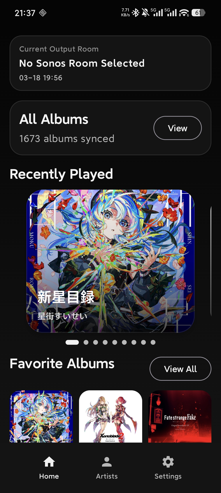
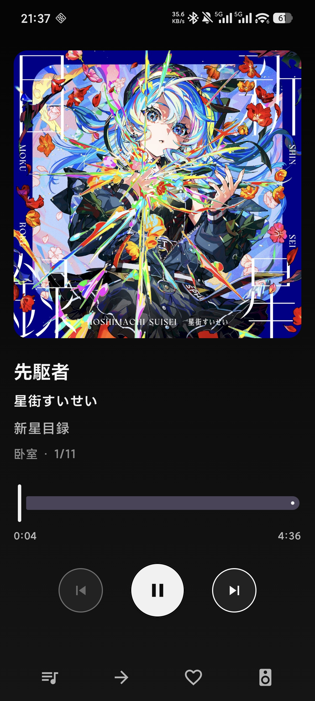
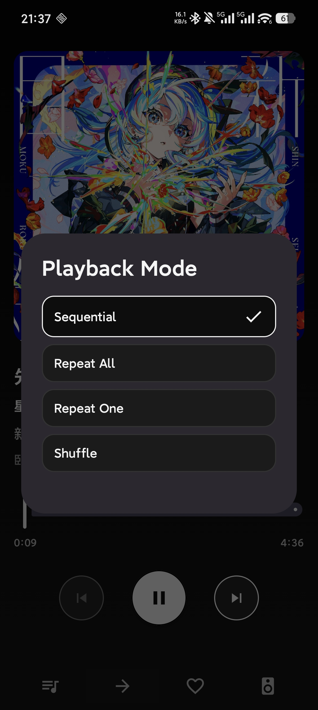
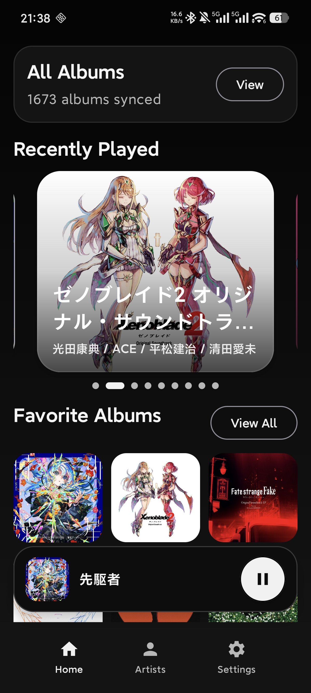
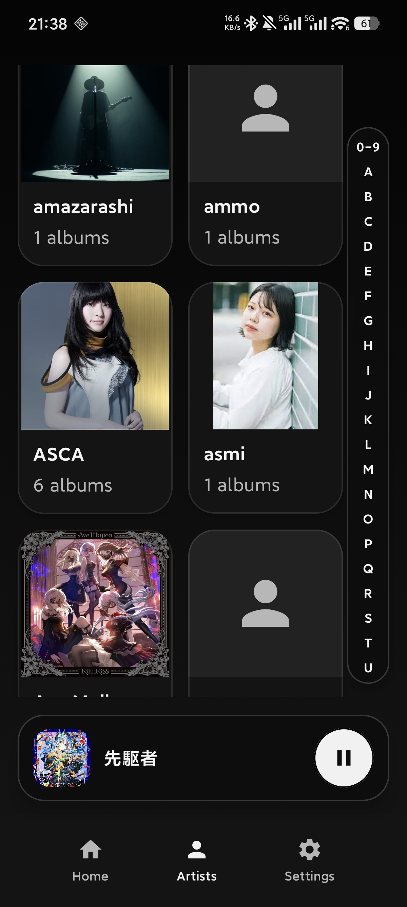

# MusicBridge

<p align="center">
  
</p>

中文 | [English](./README.md)

一个将 Plex 或 032 Music Server 音乐库桥接到 Sonos 音箱的 Android 应用。

## 下载

从 [Releases](https://github.com/lux032/MusicBridge/releases) 下载最新的 APK

## 功能特性

- 浏览 Plex 与 032 Music Server 音乐库（专辑、艺术家、歌单、收藏）
- 保存多个音乐服务器，并在设置页直接切换；每台服务器独立缓存资料库、最近播放和同步时间
- 发现并控制网络中的 Sonos 音箱
- 从 Plex 或 032 Music Server 串流音乐到 Sonos
- 实时播放控制和状态显示
- 将收藏变化、播放进度和播放完成记录同步回当前音乐服务器
- Material Design 3 界面

## 系统要求

- Android 7.0 (API 24) 或更高版本
- Plex Media Server 或 032 Music Server
- 同一网络下的 Sonos 音箱

## 安装

1. 克隆仓库
```bash
git clone https://github.com/lux032/MusicBridge.git
```
2. 使用 Android Studio 打开项目
3. 构建并在设备上运行

## 配置

首次启动时：
1. 在设置页添加音乐服务器，并选择 `Plex` 或 `032 Music Server`
2. Plex 可填写服务器地址与 Plex Token，也可使用 Plex 用户名和密码自动发现
3. 032 Music Server 填写地址（例如：`http://192.168.1.100:4533`）、API Token；媒体 Token 留空时会使用 API Token
4. 如有多台服务器，可在设置页点击服务器卡片直接切换
5. 应用会自动发现网络中的 Sonos 音箱，选择音箱后即可播放

升级旧版本时，原有 Plex 连接会自动迁移为第一个服务器。首次打开新版会重建本地音乐缓存，服务器上的音乐、收藏和播放数据不会被删除。

## 应用截图

<p align="center">
  
  
  
  
  
</p>

## 许可证

MIT
