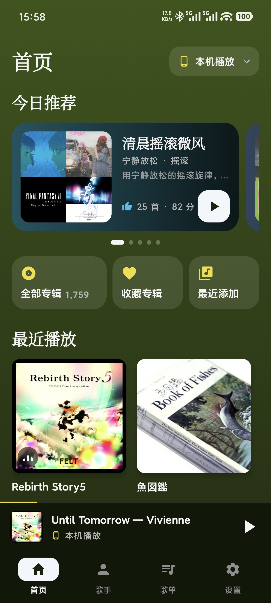
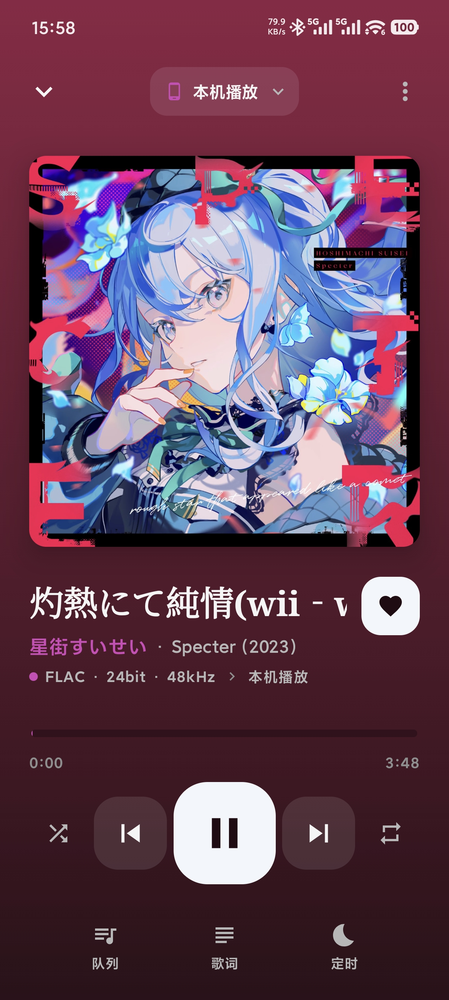

# MusicBridge

<p align="center">
  
</p>

[中文](./README.md) | English

An Android client for [032 Music Server](https://github.com/lux032/032music-server): browse your self-hosted music library on your phone and play it locally or on Sonos speakers.

MusicBridge is built primarily for 032 Music Server (playlists, Daily Mixes and durable playback sessions are 032-only features) while remaining compatible with Plex Media Server. For desktop, see [032musicplayer](https://github.com/lux032/032musicplayer).

## Download

Download the latest APK from [Releases](https://github.com/lux032/MusicBridge/releases)

## Features

### 032 Music Server

- Browse albums, artists, playlists and favorites
- Playlist management: new playlist, add tracks or whole albums from any More menu, remove with undo, rename, delete
- Daily Mixes: a swipeable home row of the mixes the server builds each day; play, like / dislike (optional reasons), replace, save as playlist, and "don't recommend" for single tracks
- Durable playback sessions (apiRevision 3): every play is a server-side session with ordered events, so play counts, skips and breakpoints stay correct across output switches, repeat loops, app restarts and crashes
- Favorites and play history synced back to the server

### Playback

- Play on this device, or discover and control Sonos speakers on your network, and switch output at any time
- Real-time playback control and status: queue, play modes, sleep timer, quality badges
- Offline downloads of original files (single tracks or whole albums), played directly from local storage when offline
- Lyrics: server or downloaded lyrics first; when none exist, synced lyrics are matched automatically from NetEase / lrclib.net (same matching strategy as 032musicplayer)

### General

- Save multiple music servers and switch between them from Settings; library caches, recently played albums and sync timestamps stay isolated per server
- Plex Media Server compatibility (browsing, playback, favorites and progress sync)
- Dark Material Design 3 UI tinted from the current album artwork, with phone and tablet layouts

## 032 playback sessions

When the active server is 032 Music Server, playback is reported through a dedicated session reporter (`Music032PlaybackReporter`) instead of the legacy timeline/scrobble calls (those endpoints were removed server-side and answer 410; the app never falls back to them):

- Each explicit play opens a fresh session (UUID) and never resumes an older chain; heartbeats renew the server lease every 15s while playing/buffering and every 60s while paused. The reporter lives with actual playback, not with the UI: the screen turning off keeps the session alive, and leaving the app fires a bounded best-effort `end(client_closed)` from a process-level reporter scope (non-blocking, cancellable transport with its own deadline) — a force kill is backstopped by the server-side 90s/10min lease.
- Repeat-one loops and track changes close the old session with its own last observed position and open a genuinely new play; user skips report `skipped`, auto-advances `completed`, failures `error` (a failed last track is never reported as a full-duration completion).
- Switching output between this device and Sonos chains the session (takeover resume), so a continuous listen counts exactly once; that takeover resume link is the only client-side use of the persisted session snapshot. Re-selecting the currently playing queue item is an explicit new play from 0 on a fresh chain; plain pause/resume and STOPPED transport re-pushes keep the chain.
- Reporting runs on a serialized actor: observations are conflated off the 1s playback loop, periodic sends back off exponentially while offline, and non-retryable rejections (401/400/404) halt reporting visibly instead of hammering the server.
- If a session stops receiving observations (reporting loop died, speaker unreachable), the reporter ends it at the last real position instead of renewing the lease forever — and keeps the resume link, so the same track coming back continues the original chain rather than counting again. Name-only server-profile edits never interrupt reporting; a token change on the same server hands the current listen over to a reporter built on the NEW credentials (no double count); a different server URL is conservatively treated as another library (the server offers no identity proof): the current track's reporting pauses with a visible notice until the next explicit play — never a fabricated cross-library resume and never an automatic high-position fresh count. If the URL change is actually the same server at a new address, the cost is that the current listen simply starts over on the next explicit play.
- Counting is derived server-side at 50% with playback evidence; the app never fakes a `playing` state for tracks that were not actually heard — recovery events may only claim `playing` when the track is playing right now or the position was provably reached while playing (a paused session that was merely seeked to a high position is never recovered as playing).
- Plex sources are untouched: they keep the existing timeline/scrobble behavior.

## Requirements

- Android 7.0 (API 24) or higher
- [032 Music Server](https://github.com/lux032/032music-server) (recommended) or Plex Media Server
- Optional: Sonos speakers on the same network (local playback works without Sonos)

## Setup

1. Clone the repository
```bash
git clone https://github.com/lux032/MusicBridge.git
```
2. Open in Android Studio
3. Build and run on your device

### Automatic APK builds with GitHub Actions

Every push and Pull Request update runs JVM unit tests and builds Debug and Release APKs. You can also start a build manually under **Actions → Build Android APK → Run workflow**.

After a successful run, download `MusicBridge-apks-<run-number>` from its **Artifacts** section. Extract the archive to get both installable APKs and `SHA256SUMS.txt`. APKs and the Release obfuscation mapping are retained for 30 days; test reports for 14 days.

- CI uses JDK 21, Android SDK 36, and the repository's Gradle Wrapper. Non-PR builds require the `KEYSTORE_BASE64`, `KEYSTORE_PASSWORD`, `KEY_ALIAS`, and `KEY_PASSWORD` secrets; missing credentials fail the build rather than publishing a debug-signed APK.
- Release APKs are shrunk and obfuscated. Branch pushes and manual builds publish production-signed test prereleases. Pushing a `v*` tag matching the app version (for example, `v1.0.0` for version `1.0.0`) publishes a stable Release marked Latest after tests and builds succeed.
- PR builds never use the production signing key. In-place upgrades require the same application ID and signature and a non-decreasing version code. A signature mismatch requires uninstalling the previous app, which clears local data.
- Failed unit tests prevent APK upload; test reports remain available for troubleshooting. Emulator/device instrumentation tests are not included in this workflow.

## Configuration

On first launch:
1. Add a server in Settings, choose `032 Music Server`, and enter its URL (for example `http://192.168.1.100:4533`) and API token; the API token is also used for media when the media token is blank
2. For Plex, choose `Plex` and enter a Plex token, or use your Plex username and password for discovery
3. Click any saved server card in Settings to switch servers
4. Pick an output on the player screen: this device, or a discovered Sonos speaker

Existing Plex settings are migrated automatically. The first launch of this version rebuilds only the local music cache; it does not delete server-side music or metadata.

## Screenshots

<p align="center">
  
  
</p>

## License

MIT
